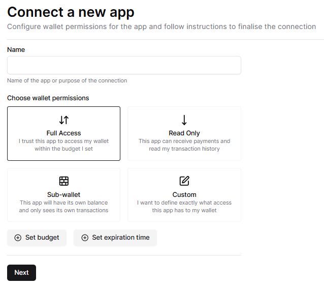
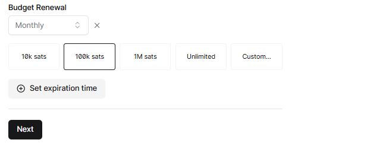

# Best Practices

Configure permissions

Wallets should support the ability to configure connections directly from the wallet service (e.g. Alby Hub allows you to define permissions such read account balance and make payments)

<figure><figcaption>
Manage access permissions example from Alby Hub
</figcaption></figure>

### Set budgets

Users are going to link their wallet account to apps to send and receive payments natively in apps. Enabling your users to set budgets creates an efficient safety measure to not overspend.&#x20;

<figure><figcaption>
Manage budgets example from Alby Hub
</figcaption></figure>

### Unique Keys

Use unique wallet keys for each connection. This keeps your user's activity across different apps completely separate.

### Sub-wallets

Sub-wallets allow your users to completely isolate their activity, so that apps can only see and access data and funds for that specific app.

